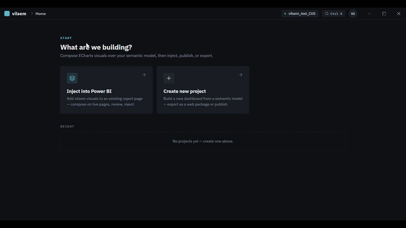

# vilsem

Round 3 evaluation patches are published: core 0.7.2 / renderer 4.42 and MCP 0.7.3. See [current tests and acceptance limits](docs/qa/stress3/round3-follow-up.md). Native host checks remain blocked and the animated 5,000-point frame-rate target fails; this is not production sign-off.

To test another report on another Windows machine, follow the [fresh-machine installation and from-scratch authoring walkthrough](https://github.com/bcsnpc/vilsem-mcp#fresh-windows-machine-recommended-installation). No Vilsem app checkout is required. The same MCP server supports Claude Code, Claude Desktop and Codex; read the [current report/visual limitations](https://github.com/bcsnpc/vilsem-mcp#current-report-and-visual-limitations) and [ten generic prompt recipes](https://github.com/bcsnpc/vilsem-mcp/blob/main/docs/author-from-scratch.md) before testing your own model.

Engineering audit: see the [verified fixes and remaining work](docs/qa/fix-status.md), [audit report](docs/qa/full-audit-report.md),
[current architecture](docs/architecture.md), and [tested regression status](docs/qa/regression-status.md).
The reproduced project-save overwrite and shared visual defects have verified local fixes. Remaining failures and acceptance gaps are documented; this is not a production-readiness certification.
For reproducible development, isolated Electron checks, and build commands, see the [QA runbook](docs/qa/test-strategy.md).

**A presentation layer for Power BI and Microsoft Fabric semantic models.**

Build a dashboard once, render it in four places: the vilsem desktop app, a standalone web app, a Power BI report, or a Fabric app. Your semantic model remains the source for queries; vilsem caches query results locally and stores dashboard specifications.



---

## The idea

Power BI couples two things that don't have to be coupled: the semantic model (relationships, measures, business logic) and the report canvas (how it looks, how it behaves, where it lives).

The model is the valuable part. It's governed, tested, and shared. The canvas is a rendering decision — and it locks you into one surface. Want the same numbers on a public web page, or embedded in an app, or styled outside Power BI's theming system? You rebuild it, and now you have two definitions of "revenue" drifting apart.

vilsem treats the semantic model as an API. Dashboards are defined separately, in a portable JSON format, and rendered wherever you need them. The DAX still executes against your model through the Power BI `executeQueries` endpoint, so every number comes from the same place it always did.

## What it does

- **Connects to an existing Power BI / Fabric semantic model** — queries the model without rebuilding it; local query caching is part of the desktop architecture
- **Authors dashboards two ways** — a visual editor, or by describing what you want in plain English
- **Compiles to an App Spec** — a portable JSON definition of layout, visuals, queries, and theme
- **Renders that spec on four surfaces** from a single definition
- **Queries through DAX** against the live model, so measures and row-level security behave exactly as they do in Power BI

## One spec, four surfaces

| Surface | Output | Status |
|---|---|---|
| **vilsem desktop** | Interactive dashboard in the Electron app | Available |
| **Web** | Standalone web application, self-hostable | Available |
| **Power BI** | Published via custom `.pbiviz` renderer | Available |
| **Microsoft Fabric** | Fabric App deployment | Feature-flagged |

The interaction model — cross-filtering, drill-down, slicers — is designed to behave consistently across all four, so a dashboard doesn't quietly degrade when you move it.

Because every surface queries the live semantic model at view time, a dataset refresh is reflected wherever the dashboard is deployed.

## Authoring

### Visual editor

Pick measures and dimensions from the model's metadata, choose visual types, arrange the canvas, set the theme. Everything is directly editable — nothing is generated behind your back that you can't then change by hand.

### Natural language (optional)

If you'd rather start from a description, vilsem can draft the dashboard for you:

> "Show revenue by product category for the last 12 months, add revenue and profit KPIs, and show the top 10 products."

It selects measures, dimensions, visual types, layout, and theme, then hands you an ordinary App Spec you can refine — by prompting again, or in the visual editor.

This is an authoring shortcut, not the product. The generated output is the same JSON you'd get from building it by hand, and the DAX it produces is visible and editable. Bring your own API key: **Anthropic, OpenAI, Gemini, or Groq**. If you never add a key, the visual editor works fully without it.

## Architecture

```
Visual editor  ──┐
                 ├──►  App Spec (JSON)  ──►  React + ECharts renderer
NL prompt ─► LLM ┘                                      │
                                                        ▼
                                              DAX via executeQueries
                                                        │
                                                        ▼
                                        Power BI / Fabric semantic model
```

The App Spec is the contract. Every renderer consumes it; nothing else is shared between surfaces. That's what makes a dashboard portable — and what makes adding a fifth target a matter of writing one more renderer.

## Visuals and interactions

**30+ visual types** — KPI cards, bar, line, area, combo, waterfall, funnel, heatmap, treemap, radar, sunburst, scatter, tables, animated bar races, and more, built on [Apache ECharts](https://echarts.apache.org/).

**Interactions** — cross-filtering, slicers, drill-down with breadcrumb navigation, detail panels, and axis switching.

## Privacy

vilsem has no backend. There is no vilsem server, no telemetry endpoint, and no account to create.

- Model queries go directly from your machine to Power BI
- LLM calls go directly from your machine to the provider you configured, using your key
- Your API keys and dashboards stay local

The only network calls are the ones you'd make anyway, to services you already have accounts with.

## Requirements

- Windows — this is the only platform vilsem has been tested on
- A Power BI / Fabric semantic model you can access
- Microsoft sign-in, or a service principal
- Node.js 20 or newer, to build from source
- Optionally, an API key from a supported LLM provider

## Install

**Download** — grab the latest build from [Releases](../../releases). Windows only for now; other platforms are untested.

**From source**

```bash
git clone https://github.com/bcsnpc/vilsem.git
cd vilsem
npm install
cd ui && npm install && cd ..

npm run electron:dev   # run in dev with hot reload
npm run build          # or build the Windows installer into release/
```

### About the Windows security warning

The installer isn't code-signed yet, so Windows SmartScreen will show **"Windows protected your PC"** the first time you run it. To continue, click **More info** → **Run anyway**.

This happens to every unsigned application regardless of what's in it — a code-signing certificate costs a few hundred dollars a year and I haven't bought one for a beta. If you'd rather not run a binary from a stranger, build from source using the steps above; it's the same code.

When a release includes a SHA-256 checksum, you can verify your download against it:

```powershell
certutil -hashfile "vilsem Setup 1.0.0-beta.1.exe" SHA256
```

## Status

**`v1.0.0-beta.2`** — beta, and labeled that deliberately. The core paths (connect, author, render, export) work end to end and are covered by tests. The App Spec format may still change before 1.0. Fabric deployment is behind a flag while it stabilizes.

Bug reports and feedback on the App Spec design are especially useful right now.

## Security

See [SECURITY.md](SECURITY.md) for the security policy, how to report a vulnerability privately, and a summary of what's been hardened. vilsem is beta software and is **not recommended for production or sensitive data**.

## Contributing

Contributions are welcome.

## License

MIT License — see [LICENSE](LICENSE). Third-party attributions (including Apache ECharts, whose license requires it) are in [NOTICE](NOTICE).
Copyright © 2026 Chiranjeevi Bhogireddy.


### Local Power BI report export (preview)
After updating, restart Electron so the new file-save IPC is available. In a Vilsem report, choose **Export / Publish -> Save as Power BI -> Choose destination and save**. Vilsem creates a separate timestamped folder with `Report.pbip`, enhanced PBIR definitions, and the bundled renderer, and displays the saved path. Open `Report.pbip` in Power BI Desktop; Desktop Save As can create PBIX. The toolbar **Save** still saves the Vilsem project.

Local-model projects offer Power BI file output only; Fabric-backed projects retain cloud/web targets too. Preview export supports a subset of visuals/settings and rejects unsupported visual types, slicers and drill settings. Full formatting/interaction parity is still being tested. See [phase status](docs/qa/phase-status.md) and [local Power BI engineering notes](docs/engineering/local-power-bi-projects.md).

### Adding visuals to existing Power BI reports

Direct existing-report insertion has been removed. Use the visual export workflow and import the exported custom visual into the destination Power BI report. Export compatibility and interaction coverage remain target-specific; consult docs/qa/target-coverage-by-visual.md.

Focused visual and deployment regressions can be run with `npm run qa:native` after starting `npm run ui:dev`. To select suites, use `npm run qa:native -- race-controls waffle-audit fabric-dialog`. These use isolated synthetic data; see [QA strategy](docs/qa/test-strategy.md) and [current regression status](docs/qa/regression-status.md) for coverage and open gaps.


## Custom visual authoring with MCP

The shared `@vilsem/core` workspace powers [vilsem-mcp](https://github.com/bcsnpc/vilsem-mcp), a local stdio server for previewing and adding Vilsem custom visuals to existing PBIR report pages. It complements native Power BI report/model authoring tools. See its README for installation, supported compositions, model-connection setup and verification limits.

Standalone model connections: [`@vilsem/core/connect`](packages/core/README.md#standalone-model-connections-021). MCP needs no Vilsem app checkout.
