# Vilsem architecture — initial engineering audit

Repair update: [verified changes](qa/fix-status.md) align editor query invalidation/error propagation, retain viewer cards on empty/error, validate custom templates and nested slicers, preserve dimension-only tables through desktop DAX, and reject project-name collisions. Save still uses the legacy name/dataset lookup; stable-ID migration is deferred. The dependency map below remains the baseline architecture.

Inspected 2026-09-07. This is the current baseline; [the April snapshot](architecture/current-state.md) is historical. Implementation references below are relative to the repository root. Runtime evidence and limits are in [regression status](qa/regression-status.md).

## Product and entry points

Vilsem authors portable App Spec dashboards over Power BI/Fabric semantic models. Desktop authoring, standalone web rendering, Power BI injection/publishing and Fabric deployment are related but distinct workflows. The desktop does not run through `npm start`: that command starts the Fastify service in `src/app.js`.

| Boundary | Actual implementation | Responsibility |
|---|---|---|
| Electron launcher | scripts/launch-electron.js | Remove Electron-as-Node environment flags and spawn electron/main.js |
| Desktop main | electron/main.js | Writable profile path, cache/auth/metadata startup, CSP, IPC registration, frameless BrowserWindow |
| Preload API | electron/preload.js | Explicit window.semantica methods via ipcRenderer.invoke; startup event buffering |
| React root | ui/src/main.jsx → App.jsx | StrictMode, app error boundary, toast/theme providers, page state and auth routing |
| Navigation | App.jsx → vilsem/Shell.jsx | Setup, optional AI onboarding, Home, AppGenerator, PbiInjector, PbiRestyler |
| Authoring | pages/AppGenerator.jsx | generatedSpec React state, active page, messages, selections, project save and output workflows |
| Editor | appspec/CanvasEditor.jsx + VisualInspector.jsx | Pixel dragging/resizing, field/config mutations, editor data requests, live visuals |
| Viewer | appspec/AppSpecRenderer.jsx | Normalized layout, per-visual requests, filters, drill, detail panels, view/edit branches |
| Leaf dispatch | appspec/visuals/index.js | 41 registry IDs and wrapper-attached schema arrays |
| Query engine | electron/ipc/query.js → src/fabric/* | Scalar batching, DAX translation, table/distinct queries, error classification/repair, cache |
| Persistence | electron/ipc/dashboard.js → src/cache/sqlite.js | sql.js database exported to disk; saved specs keyed by dataset/name for update |
| Web transport | standalone/index.jsx + src/app.js/exportPackage.js | HTTP window.semantica adapter and local/self-hosted service |
| Fabric embed | standalone/fabric-embed.jsx → StandaloneApp.jsx | Same React viewer with host-installed query transport |
| Power BI | pages/powerbi/*, AppSpecToPowerBI.js, vilsem-renderer | App Spec mapping, PBIR/DAX/HTML generation, custom host selection/filter APIs |

Legacy navigation pages and renderer alternatives remain on disk. Their existence does not establish reachability from the current router. `CompactTableEcharts` is HTML, and `CompactSunburst` still uses Recharts. Dependencies alone are not an architecture diagram.

## Manual editing flow

```mermaid
flowchart LR
  U[User field or property edit] --> I[VisualInspector]
  I --> E[editSpec: clone active page]
  E --> S[AppGenerator generatedSpec]
  S --> C[CanvasEditor or AppSpecRenderer]
  C --> Q[window.semantica query / queryTable]
  Q --> IPC[Preload to main IPC]
  IPC --> D[DAX / Fabric execution / cache]
  D --> N[Normalized rows]
  N --> V[VISUAL_MAP component]
  C --> V
  V --> P[Primitives or dedicated DOM/SVG/options]
  P --> O[Rendered visual]
```

`VisualInspector.updateConfig` merges a config key, `updateData` merges a data key, and `updatePos` edits position through the passed editSpec callback. AppGenerator owns the document; `vilsem/canvasStore.js` is a small pub/sub bridge for shell panes, not the canonical persisted state. Injector reuses `specEditing.js`, whose helpers duplicate some AppGenerator logic rather than being adopted by it.

Visual records carry `id`, `type`, `position`, `data`, `config`; multi-page specs carry pages with visuals/slicers, while hosts consume a flattened current page. `data` includes measures, groupBy, optional dimensions, filters, limits and order. Custom templates add customTemplateId/customVisuals. Runtime chart config injects `_T`, selected category, click/drill callbacks and template/context fields; these are not persisted user settings.

Data requests and config assembly exist in both editor and viewer. Scalar and category results normalize to `_cat`, `_val`, `_val2`, `_val3`; tables use `_cats`/`_vals` arrays. Bar race consumes frame/category arrays. Trace per-visual role limits rather than assuming every renderer consumes all measures.

## AI editing flow

Inspector refinement prefixes an instruction restricting patches to the selected visual's config; this is not by itself a typed capability boundary. Page refinement sends a page slice. `validatePatchOperations` permits add/replace/remove, checks pointer parent existence and measure names; new config properties can be upserted. It is not comprehensive per-renderer property validation. The frontend rejects removal of all visuals, validates the result and appends user/AI feedback.

Full generation has additional model-context selection, programmatic generation/sanitization and layout paths in `llm.js`. The visual-schema hint map is handwritten separately from runtime primitive schemas. Provider requests return parsed JSON, rather than all operations being expressed as one canonical typed function schema. Custom template generation is separate: `playgroundAI.js` sends a declarative template prompt through generateCustomTemplate, validates and retries once; `instantiate.js` converts slots/params/theme into ECharts options without arbitrary generated JS.

## Interaction and layout

Viewer globalFilters/filterSources track slicer and mark-sourced filters. `buildAppliedFiltersForVisual` applies slicer targeting and avoids filtering the source chart for ordinary mark-sourced selection. `_onBarClick` is the leaf-to-host callback. Editor selection/drag and viewer filtering are separate state paths; Power BI also has its own selection manager and JSON filter integration. Multi-select parity is unverified.

CanvasEditor converts a 12-column position model to pixels and back, compensates for zoom, and limits resize drag to at least 60×40 pixels before grid conversion. It uses nested overflow:hidden. Viewer `normalizeLayout` rearranges non-freeform specs, but skips freeform documents. This function currently drops dimension-only tables. Shared EChartsCanvas owns init/setOption/ResizeObserver/dispose; bar race owns a different lifecycle. Plot clipping and host clipping must be verified separately.

## Persistence and dependencies

Main sets SEMANTICA_DATA_DIR to Electron userData before loading cache modules. sql.js persists an exported database under cache/semantica.db. Workspaces use workspaces.json under userData; API keys remain in main-process facilities. Save passes name/dataset/spec; chat history is stored as `_chatMessages` and removed from the rendering spec on load. Save/reopen isolation, duplicate names and disk-write failures require tests.

Before changing the spec/config contract, inspect the inspector, both hosts, AI hints/sanitizer, standalone/Fabric adapters, Power BI mapping/HTML templates, custom template instantiation and persistence. Before changing a primitive, inspect every registry wrapper using it. Before changing layout, inspect editor pixel conversions, viewer normalization and Power BI page mapping.

## Known limits

This is an initial runtime trace, not a completed audit of every branch. Live Microsoft auth, real model discovery/querying, cloud AI and external publishing were not exercised. Release packaging is held for BUILD-001 investigation. The README's “no data copies” wording needs qualification: local query caches and some static export paths exist.
